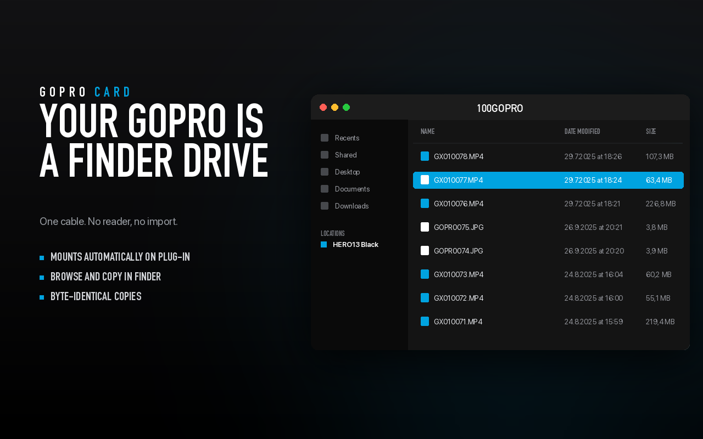

# GoPro Card

Mount a GoPro over USB as an ordinary macOS volume. Plug the camera in, a drive appears in
Finder, drag the footage out.



No card reader, no import queue, no third-party drivers, no kernel extensions.

## The problem

An action camera over USB is **not** a flash drive. It speaks MTP/PTP, and macOS ships no MTP
driver, so Finder never offers it as a disk. The usual answers are a card reader, GoPro Quik, or
a third-party file manager.

Newer cameras (HERO8 Black and later, MAX) expose a second, much nicer interface: in **GoPro
Connect** mode the camera also behaves like a USB Ethernet adapter and serves its media over
HTTP. This project bridges that endpoint to WebDAV and hands it to macOS's built-in
`mount_webdav`, so the camera becomes a real mounted volume.

```
Camera ──USB──> en9 (172.20.x.x)         GoPro Card                   macOS
                HTTP :8080      ──>  loopback WebDAV bridge  ──>  mount_webdav  ──>  /Volumes/HERO13 Black
                /gopro/media/list        (127.0.0.1, read-only)
                /videos/DCIM/...
```

Nothing is installed beyond this app: the mount, the volume and the Finder integration are all
stock macOS pieces.

## Requirements

| | |
|---|---|
| Camera | HERO8 Black or newer, or MAX, with **Preferences ▸ Connections ▸ USB Connection ▸ GoPro Connect** |
| Mac | macOS 13 or newer |
| Cable | any USB data cable (charge-only cables will not work) |

HERO7 and older only speak MTP and cannot be mounted without a kernel driver — use a card
reader for those.

## Install

```bash
brew tap pokidov/tap
brew trust pokidov/tap
brew install --cask gopro-card
```

The build is ad-hoc signed rather than notarized, so macOS blocks the first launch. Approve it
once in **System Settings ▸ Privacy & Security ▸ Open Anyway**, or clear the flag:

```bash
xattr -dr com.apple.quarantine "/Applications/GoPro Card.app"
```

Uninstall with `brew uninstall --cask gopro-card`, or `--zap` to remove logs and preferences too.

## Build from source

```bash
./build.sh                 # builds "GoPro Card.app" (no Xcode project, no dependencies)
./install.sh --login       # copies to /Applications and starts it at login
```

Or drag `GoPro Card.app` to `/Applications` and launch it. It runs in the menu bar; there is no
Dock icon.

## Use

1. Plug the camera in and turn it on.
2. After a few seconds the volume appears in Finder.
3. Drag files off it. Eject from the menu bar, or just pull the cable — the app cleans up.

The menu bar item offers: Show Camera Files, Mount/Unmount, Open at Login, Use Camera Name as
Disk Name…, Open Log, Quit.

```bash
"/Applications/GoPro Card.app/Contents/MacOS/GoProCard" --doctor    # what can it see?
"/Applications/GoPro Card.app/Contents/MacOS/GoProCard" --status
```

## Design notes

Three details do most of the work, and all three were learned the hard way:

- **Spotlight.** The bridge exposes a zero-length `.metadata_never_index` at the volume root.
  Without it, `mds` tries to read the entire card and saturates the camera's USB link.
- **Range requests.** macOS's WebDAV client opens a file with "everything from offset N to the
  end". Handing that through verbatim means a 226 MB transfer that must drain even after `cp`
  closes the file, which stalls the copy. `cappedRange` answers in 4 MB slices instead.
- **Mount points.** macOS only lets Finder create entries in `/Volumes`, and WebDAV unmounts
  delete them again. `--prepare-volume` creates the mount point once with your administrator
  password and seeds it with a `.keep` file so it survives.

## Limitations

- **Read-only.** The camera's HTTP interface is download-only, so the volume mounts read-only.
  Nothing on the card can be modified or deleted by accident.
- **Speed** is bounded by the camera's own HTTP server — roughly 6–9 MB/s on a HERO13, slower
  than a card reader but fine for pulling footage.
- **One camera at a time** per mount point.

## Why it is not on the Mac App Store

Mac App Store apps must be sandboxed, and the sandbox blocks `mount_webdav`. Measured on
macOS 26: the same binary mounts fine unsigned, and fails with `EINVAL` once the
`com.apple.security.app-sandbox` entitlement is added — the WebDAV filesystem's own agent is
denied the socket it needs. Shelling out does not escape it, because child processes inherit
the sandbox.

An App Store build would have to use a File Provider extension (`NSFileProviderReplicatedExtension`)
instead of mounting, which appears as a sidebar location rather than a `/Volumes` drive.
Details in [`appstore/SUBMISSION.md`](appstore/SUBMISSION.md).

## Layout

| Path | Role |
|---|---|
| `Sources/GoPro.swift` | camera discovery, media catalogue, virtual `DCIM/` tree |
| `Sources/WebDAV.swift` | loopback WebDAV server: `PROPFIND`/`GET`/`HEAD`/`OPTIONS`, range proxying |
| `Sources/Mount.swift` | mount strategy, health checks, teardown, stale-mount recovery |
| `Sources/MenuBar.swift` | status item, login item |
| `Sources/Store.swift` | StoreKit purchase scaffolding (disabled by default) |
| `Sources/Support.swift` | process, port and mount-table helpers |
| `Tools/make_assets.py` | generates the icon and screenshots with Pillow |
| `appstore/` | icon, screenshots, submission metadata |

## License

MIT — see [LICENSE](LICENSE).

GoPro is a trademark of GoPro, Inc. This project is not affiliated with, endorsed by, or
sponsored by GoPro. It talks to the camera's public HTTP endpoints the same way the official
apps do.
